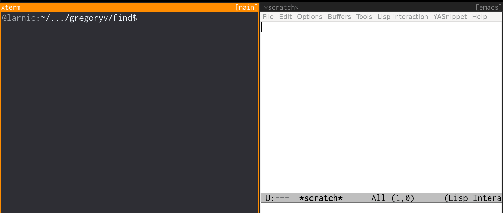

ARCHIVED! Moved to https://sogvin.com/find

[find](https://godoc.org/github.com/gregoryv/find) - Go package for locating files

## Usage

See [package examples](https://godoc.org/github.com/gregoryv/find#pkg-examples)!

## cmd/ifind

    $ go install github.com/gregoryv/find/cmd/ifind@latest
    $ ifind --help

ifind supports emacs and vi editors when opening to specific line.

